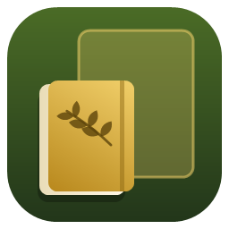
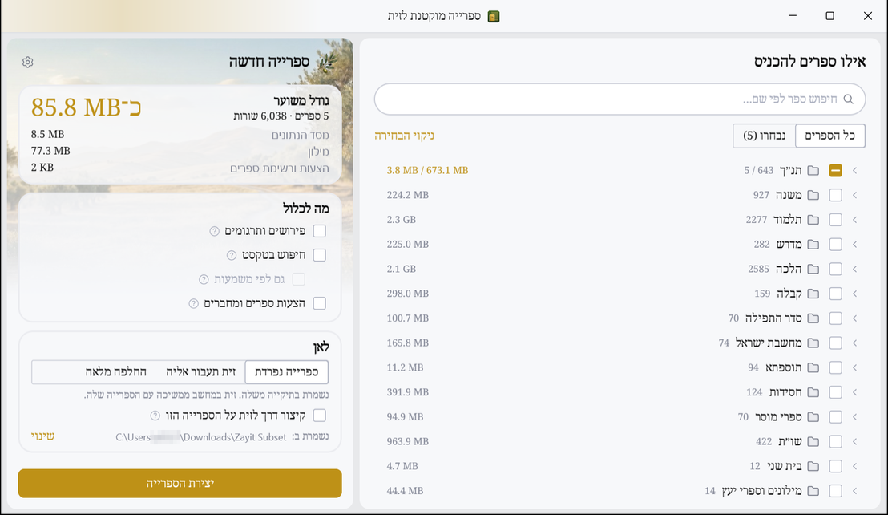
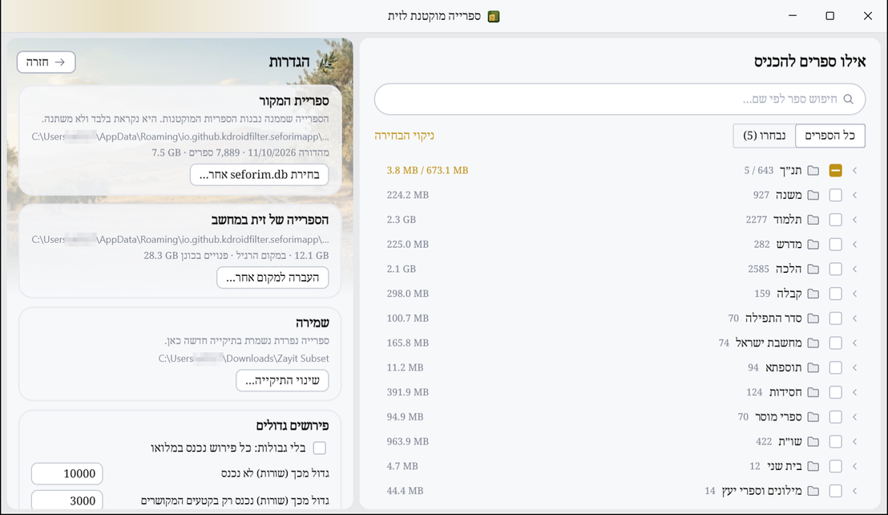

<div dir="rtl">



# ספרייה מוקטנת לזית

**Build a small library of chosen books from the desktop Zayit library: for the Zayit Android app, for a second computer, or for desktop Zayit itself.**

הספרייה המלאה של זית שוקלת כמה ג׳יגה־בייט. הכלי הזה בונה ממנה ספרייה קטנה עם הספרים שבוחרים בלבד, יחד עם הפירושים והתרגומים שלהם וחיפוש שעובד בדיוק כמו בספרייה המלאה. את הספרייה הקטנה אפשר להעביר לטלפון, לפתוח בזית למחשב או להחליף בה את הספרייה של זית.

> כלי לא רשמי. אינו קשור למפתח של זית.

## צילומי מסך

| בחירת הספרים והגודל המשוער | הגדרות |
|:---:|:---:|
|  |  |

## מה הוא עושה

- **בחירת ספרים מעץ הספרים של זית:** עם חיפוש לפי שם. ליד כל שורה ותת־שורה מוצג כמה היא תוסיף לספרייה.
- **גודל משוער מראש:** לכל חלק בנפרד, כלומר מסד הנתונים, החיפוש, המילון וההצעות.
- **פירושים ותרגומים:** מה שמקושר לספרים שנבחרו נכנס אוטומטית.
  - פירוש גדול נכנס רק בקטעים המקושרים, ופירוש גדול מאוד לא נכנס.
  - אפשר לבחור לכל פירוש בנפרד: במלואו, רק הקטעים המקושרים, או בלי. אפשר גם לבטל את הגבולות.
- **חיפוש:** אינדקס החיפוש של זית, מסונן לשורות שנכנסו.
  - אפשר לשמור גם את הווקטורים של החיפוש לפי משמעות. רק זית למחשב משתמשת בהם.
  - הצעות ספרים ומחברים, ורשימת הספרים (`catalog.pb`).
- **אחרי הבנייה:**
  - ספרייה נפרדת, עם קיצור דרך לפתוח בה את זית.
  - זית במחשב עוברת אליה. החזרה לספרייה הרגילה נעשית מההגדרות.
  - החלפה מלאה של הספרייה של זית, אחרי אישור מפורש.
  - העברה לטלפון דרך adb.
- **העברת הספרייה המלאה של זית** למקום אחר, גם לכונן חיצוני.

העיצוב הוא של זית: Kotlin, Compose ו־Jewel בערכת Islands, הצבע שלה והגופן Noto Serif Hebrew.

## התקנה

1. מורידים את `ZayitSubset-windows-x64.zip` מעמוד ה־[Releases](../../releases/latest).
2. פורסים לתיקייה כלשהי ומפעילים את `ZayitSubset.exe`.

סביבת ההרצה (JetBrains Runtime 25) כלולה בקובץ, ולכן אין צורך להתקין Java. הקובץ אינו חתום דיגיטלית, ולכן Windows SmartScreen עלול להזהיר בפעם הראשונה. כדי להמשיך לוחצים על "מידע נוסף" ואז על "הפעל בכל זאת".

**דרישות:**
- Windows 10 או 11, ‏64 סיביות.
- זית למחשב מותקנת, עם הספרייה המלאה שלה.
- להעברה לטלפון: כבל USB, ניפוי באגים מופעל בטלפון, ו־adb מותקן.

## חשוב לדעת

- הספרייה המקורית נקראת בלבד ולא משתנה. ההחלפה המלאה של הספרייה של זית מוחקת אותה רק אחרי אישור מפורש.
- המודל של החיפוש לפי משמעות מוגן בזכויות יוצרים של זית, ואסור להעתיק אותו אל מחוץ לזית. הכלי לא מעתיק אותו. הוא רק משאיר באינדקס את הווקטורים של השורות שנבחרו, למי שבוחר בכך.
- ספרייה מחוץ לתיקייה הרגילה של זית משתמשת בהגדרה של זית עצמה. עם זאת, זית לא תומכת בה רשמית.

## בנייה מקוד המקור

צריך JetBrains Runtime 21 כדי לקמפל, ו־JetBrains Runtime 25 כדי להריץ. Jewel 0.41 בנוי ל־Java 25.

```powershell
# JBR 25 ב־%USERPROFILE%\.jdks\jbr-25, או נתיב אחר דרך -Pjbr25=...
.\gradlew.bat appLibs                                   # build\app\lib
powershell -ExecutionPolicy Bypass -File install.ps1   # בנייה והתקנה ל־%LOCALAPPDATA%\Programs\Zayit Subset
```

את המיקום של JBR 21 Gradle מוצא דרך `org.gradle.java.installations.paths` ב־`gradle.properties`.

הבנייה ב־GitHub Actions רצה רק כשמפעילים אותה: לשונית Actions ← Build ← Run workflow. עם מספר גרסה (למשל `v1.0.1`) היא בונה ומפרסמת Release עם קובץ ה־zip. בלי מספר גרסה היא רק בונה.

## מבנה הפרויקט

| מיקום | תפקיד |
|---|---|
| `src/main/kotlin/zayit/subset/data/Builder.kt` | הבנייה: התוכנית, מסד הנתונים המוקטן, סינון האינדקסים, הערכת הגודל |
| `data/Library.kt`, `BookSizes.kt`, `Catalog.kt` | קריאת הספרייה, משקל כל ספר, `catalog.pb` |
| `data/DesktopZayit.kt`, `ReplaceLibrary.kt`, `MoveLibrary.kt` | זית למחשב: פתיחה, מעבר, החלפה, העברה |
| `data/Device.kt` | העברה לטלפון דרך adb |
| `ui/` | המסכים: עץ הספרים והחלונית שבצד, כלומר בנייה, תוצאה והגדרות |
| `theme/` | ערכת העיצוב של זית 0.6.4 |
| `launcher/Launcher.cs` | `ZayitSubset.exe`: מפעיל את התוכנה על סביבת ההרצה שלידו, ופותח את זית על ספרייה מוקטנת עבור קיצורי הדרך |
| `install.ps1` | בנייה והתקנה מקומית |

## רישיון

AGPL-3.0, עם התנאים הנוספים של זית. ראו `LICENSE`.

**Powered by the technologies that drive Zayit — https://zayitapp.com/**

בכלי יש קוד, עיצוב ותמונות מ־[זית](https://github.com/kdroidFilter/Zayit) (AGPL-3.0). הגופן Noto Serif Hebrew מופץ ברישיון SIL Open Font License 1.1, ראו `src/main/resources/font/OFL.txt`. הספריות שבשימוש:
- Compose Multiplatform ו־Jewel (Apache-2.0)
- Apache Lucene (Apache-2.0)
- sqlite-jdbc (Apache-2.0)
- kotlinx (Apache-2.0)

סביבת ההרצה JetBrains Runtime מופצת ברישיון GPL-2.0 with Classpath Exception.

© 2026 efrul

</div>
